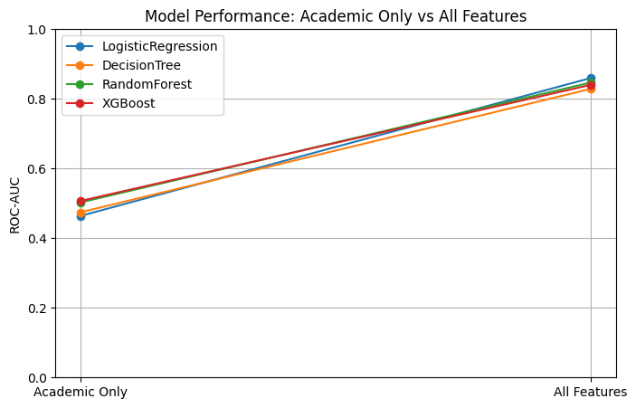
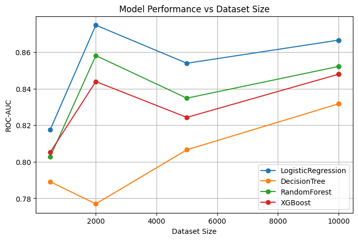

# Student Academic Risk Prediction

A machine learning study on **identifying at-risk students early**. It looks at what you gain by combining academic, behavioral, emotional and demographic data, compared with using grades alone.

> **Note:** This project uses a **synthetic dataset** of 10,000 students generated with a rule-based simulator. It is meant to demonstrate a complete, reproducible modeling pipeline, not to make claims about real students.

## Research question

> Are grades alone enough to flag a student at risk, or do engagement and wellbeing signals matter?

The project started with a literature review of recent studies on student-performance prediction. It covered the methods used, the reported results and their limitations. The review found two common gaps: **small single-course datasets** and **features that are almost all academic**. This project explores both.

## Data

The simulator generates 10,000 students with four groups of features:

| Group | Features |
|---|---|
| Academic | ability, midterm, practical, writing |
| Behavioral | study hours, LMS sessions, avg. session length, forum posts, dropped courses |
| Emotional | motivation, stress level, forum sentiment |
| Demographic | gender, parent education, internet access, distance from home |

**Target:** a binary *at-risk* label (about 30% positive).

## Method

- **Encoding and scaling:** One-hot encoding for categorical features, and standard scaling. The scaler is fit on the training split only.
- **Class balance:** Stratified train/test split, plus oversampling with `imbalanced-learn` to handle class imbalance.
- **Models:** Four models compared:
  - Logistic Regression
  - Decision Tree
  - Random Forest
  - XGBoost
- **Two experiments:**
  1. **Academic features only** vs **all features**
  2. **Learning curves:** performance as the dataset grows from 500 to 10,000 students

## Results

| Model | Academic only: ROC-AUC | All features: ROC-AUC | All features: accuracy |
|---|---|---|---|
| Logistic Regression | 0.46 | **0.86** | 77.6% |
| Decision Tree | 0.47 | 0.83 | 74.1% |
| Random Forest | 0.50 | 0.85 | **79.9%** |
| XGBoost | 0.51 | 0.84 | 74.4% |

  
  

**Findings:**

- **Features:** Academic features alone performed at chance level (ROC-AUC about 0.5). Adding behavioral and emotional features raised ROC-AUC to 0.83–0.86. This is expected here, because the simulator builds the risk label from engagement and wellbeing signals. In real data, this experiment would test whether those signals actually carry that information.
- **Model choice:** Logistic Regression had the most consistent ROC-AUC. Random Forest and XGBoost improved steadily as the dataset grew.

## Next steps

- Validate the pipeline on a real, anonymized student dataset.
- Add explainability (e.g., SHAP) so advisors can see why a student was flagged.

## Tech stack

Python · pandas · NumPy · scikit-learn · XGBoost · imbalanced-learn · Matplotlib
